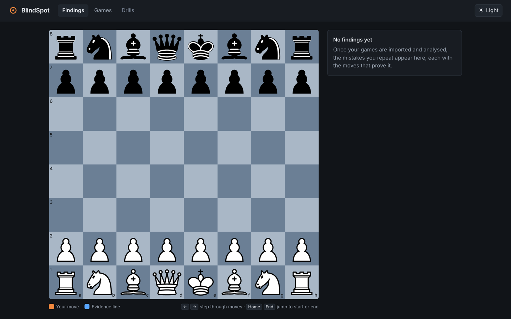
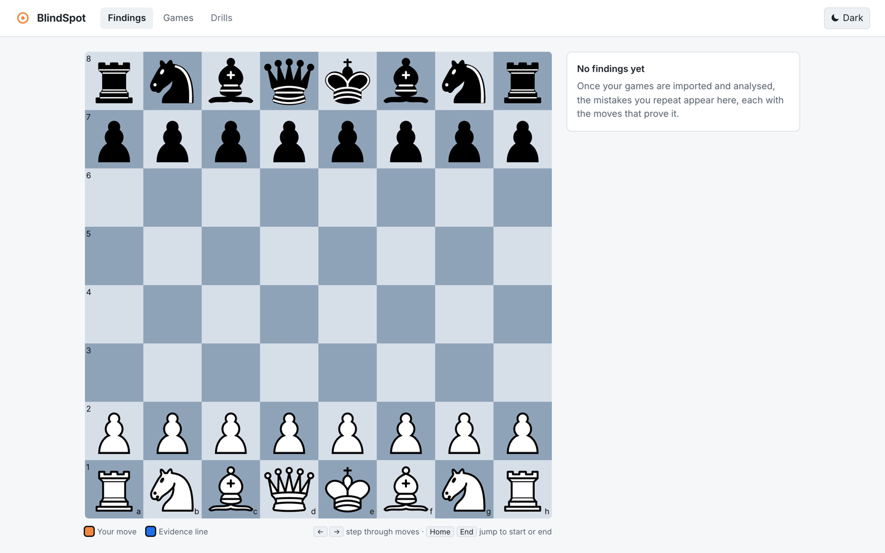

# frontend

The BlindSpot web app: React 19 + TypeScript (strict), built with Vite. Design decisions: [ADR 0007](../docs/decisions/0007-frontend-board-and-visual-identity.md).

So far it is the **app shell** (#50): header and navigation, the board (react-chessboard, starting position), the legend and keyboard hint, an empty side panel, and the dark and light theme. The findings screen comes in #24, backed by the read-only API of #51.

| Dark (default)                                                   | Light                                                              |
| ---------------------------------------------------------------- | ------------------------------------------------------------------ |
|  |  |

## Run it

In Docker, with the rest of the stack (from the repository root): `docker compose up --build`, then http://localhost:8081. nginx serves the build and proxies `/api` to the backend.

Locally, with Node 26 (the version in `.nvmrc`; `nvm use` picks it up):

```bash
cd frontend
npm ci
npm run dev        # http://localhost:5173, /api proxied to the backend on :8080
```

| Command                                   | What it does                                                       |
| ----------------------------------------- | ------------------------------------------------------------------ |
| `npm run lint`                            | ESLint (typescript-eslint, strict type-checked rules, React hooks) |
| `npm run format:check` / `npm run format` | Prettier                                                           |
| `npm run typecheck`                       | `tsc --noEmit`                                                     |
| `npm test`                                | Vitest + Testing Library, including the contrast test              |
| `npm run build`                           | Type check, then the production build in `dist/`                   |

CI runs all of them in the job "Frontend (lint + test + build)".

## Theme

All colours are CSS custom properties in [`src/theme/theme.css`](src/theme/theme.css), one block per theme; components only use `var(--...)`. The theme is set by `data-theme` on `<html>`: dark by default, light as an option, remembered in `localStorage` (`blindspot.theme`). An inline script in `index.html` applies the stored theme before the first paint; if storage is unavailable, the page stays dark and the toggle still works for the session.

**Contrast is tested, not assumed.** [`src/theme/contrast.test.ts`](src/theme/contrast.test.ts) reads `theme.css` and checks every text colour on every background (4.5:1), the board coordinates on both square colours (4.5:1), the focus ring (3:1), and the highlight rings on both square colours (3:1), in both themes. A colour change that breaks WCAG AA fails CI.

**Highlights are rings, not fills.** The orange ("your move") and blue ("evidence") reach only 1.0 to 1.9:1 as a plain fill on the blue-grey squares (one case 3.4:1). So a highlighted square gets an orange or blue ring between two dark halo rings ([`highlight.ts`](src/theme/highlight.ts)): the halo meets the square, the colour meets the halo, and both pairs pass. The legend swatches use the same halo.

## Licences

The bundled piece set, font and libraries are listed in [THIRD_PARTY_NOTICES.md](../THIRD_PARTY_NOTICES.md).
